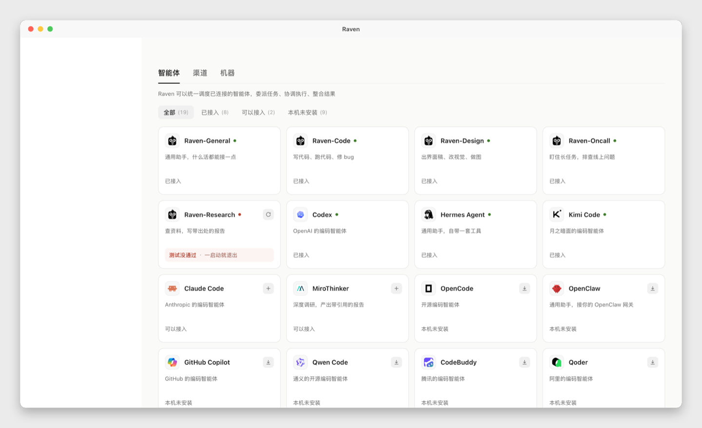
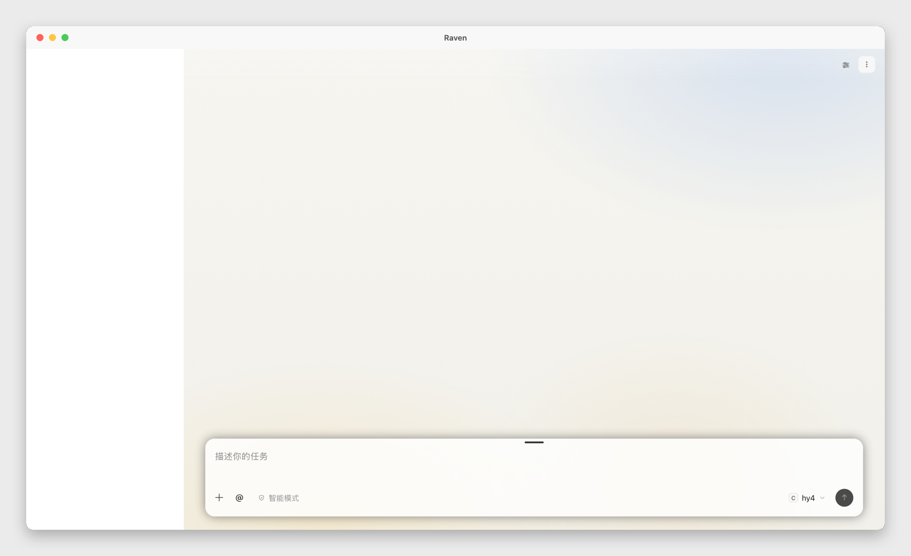

# Raven Desktop

A small macOS app that puts the [Raven](https://github.com/EverMind-AI/Raven)
web UI in its own window. Raven's `raven web` command already serves the full
UI in a browser; this app is the window around it, so you can launch Raven
from the Dock and keep it out of a browser tab.

This is an independent project. It is not maintained by EverMind-AI. The app
does not fork the Raven frontend or ship a second copy of it: it uses the
`raven` CLI already installed on the machine and loads the page that CLI
serves. That means changes to Raven itself arrive without a rebuild here, and
anything we add to this repository stays in this repository.





The two images above are real page captures with a macOS window frame drawn
around them. Raw captures without the frame are in
[docs/screenshots/](https://github.com/hyi1233/Raven-Desktop/tree/main/docs/screenshots) (`01-new-task.png` and
`02-connections.png`). Screen recording is blocked on the machine used for the
captures, so the frame is drawn in code rather than photographed; the content
inside it is the running app.

## Why a separate repository

The desktop code was first proposed upstream as
[PR #1246](https://github.com/EverMind-AI/Raven/pull/1246) from a `desktop`
branch of a fork. That PR stays as it is. Keeping the desktop work here instead
means:

- screenshots, docs and release notes live with the code that produces them;
- the desktop app has its own issues, tags and release cadence;
- upstream can change its CI, frontend or auth flow without breaking our work,
  and we can add features here without asking anyone to merge them.

## Build and run

Needs macOS 12+, the Xcode Command Line Tools (`swiftc`, `sips`, `iconutil`)
and the `raven` CLI on `PATH` or at `~/.local/bin/raven`.

```sh
cd macos
./build.sh                 # builds ~/Applications/Raven.app
open ~/Applications/Raven.app
```

Set `RAVEN_DESKTOP_APP=/path/to/Raven.app` to build elsewhere. The build
compiles the Swift source, renders `macos/Resources/raven-mark.svg` into an
`.icns`, assembles the bundle and signs it ad hoc. Build output goes into
`macos/build/` and is ignored by git.

On a Mac that has not opened the app before, Gatekeeper may ask for
Right-click -> Open, or you can re-sign with a Developer ID.

## How it works

On launch the app runs `macos/scripts/launch.sh`. That script makes sure a
resident `raven web` is up, reads the one-time authenticated URL from the
gateway, and prints it. The app loads it into a `WKWebView`.
`BROWSER=/usr/bin/true` keeps the CLI from also opening a browser tab.

The launcher finds `raven` on `PATH` (with a `~/.local/bin` fallback for Finder
launches), reads its shebang for the right Python interpreter, and takes the
port from the gateway's own state file. No user names, home directories or
ports are baked in. If the gateway is not running, it starts one; if WebKit's
content process dies, the app reconnects. Cmd-Shift-R reconnects manually.
Links that leave localhost go to the system browser. Closing the window quits
the app but leaves the gateway running.

More detail is in [macos/README.md](macos/README.md).

## What works today, and what does not

Works: a native window with menus, reload and reconnect, external links in the
system browser, the official raven icon, and a build that needs nothing beyond
the CLI and Xcode tools.

Not there yet: only macOS; ad hoc signed rather than notarized; no packaged
`.dmg` or auto-update; the launcher assumes `raven web` keeps serving
`/auth#<nonce>`. The menu titles are in English, while the page itself uses
Raven's own language settings.

## What we plan to work on

Small steps, added as they are ready: a menu bar item so the window can be
hidden without quitting, a packaged `.dmg` for people who do not want to run a
build script, a couple of window shortcuts, and a check that warns when the
installed CLI is too old for the launcher. Nothing here depends on a change in
upstream Raven.

## Credits and license

Raven itself, the web UI and the raven mark belong to
[EverMind-AI](https://github.com/EverMind-AI/Raven) and are Apache-2.0
licensed; see [NOTICE.md](NOTICE.md). The code in this repository is
Apache-2.0 licensed too. This project is a desktop shell around that software,
not a replacement for it.
