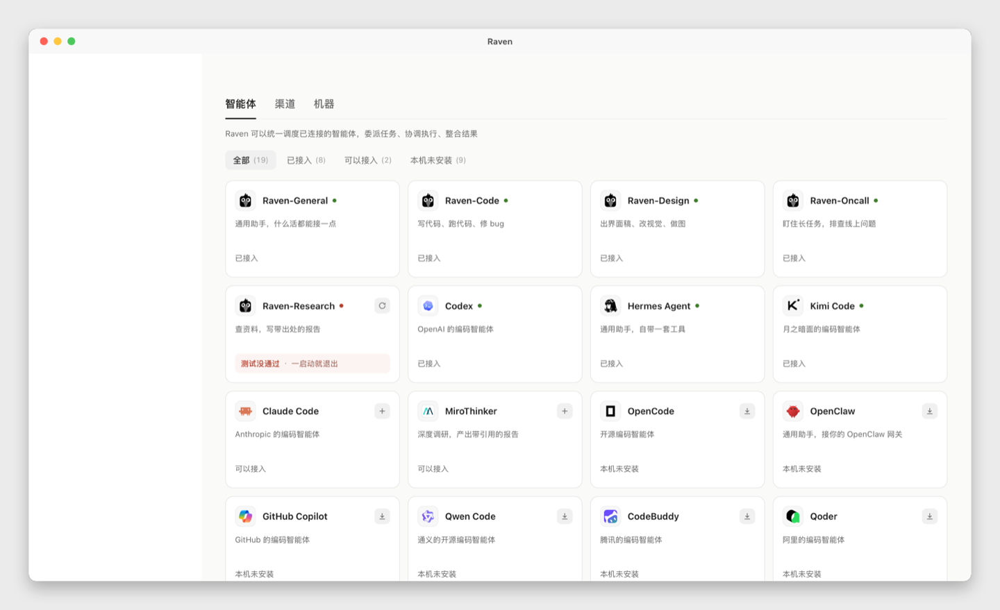
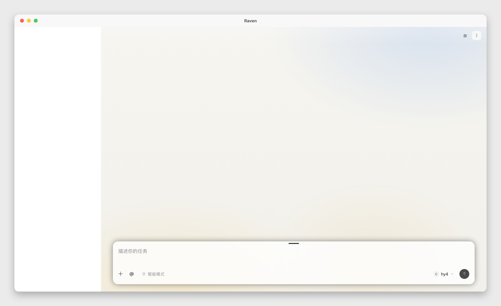

# Raven Desktop

把 [Raven](https://github.com/EverMind-AI/Raven) 的网页界面装进一个独立的
macOS 窗口。`raven web` 本来就会在浏览器里打开完整界面，这个 App 只是给
它一个自己的窗口：可以从 Dock 启动，也不用在一堆标签页里找它。

这是独立项目，不是 EverMind-AI 维护的东西。App 不复制也不改动 Raven 的
前端，它调用机器上已经装好的 `raven`，加载那个命令提供的页面。所以 Raven
自己更新，这边不用跟着重新构建；我们在这边加功能，也不会影响上游。





上面两张是真实运行画面的截图，外面那层 macOS 窗口边框是画上去的。截图用的
机器没有屏幕录制权限，没法直接拍窗口，所以边框用代码合成，里面是实际跑起来
的页面。没有边框的原始截图在
[docs/screenshots/](docs/screenshots/)（`01-new-task.png`、`02-connections.png`）。

## 为什么要单独建仓库

桌面端最初是以 fork 里的 `desktop` 分支向原作者提了
[PR #1246](https://github.com/EverMind-AI/Raven/pull/1246)，那个 PR 保持原样。
把后续工作放在这里，是因为：

- 截图、文档、发布说明和产生它们的代码放在一处；
- 桌面端有自己的 issue、版本和发布节奏；
- 上游改 CI、前端或认证方式，不会把我们的工作搞坏；我们加功能也不用等谁合并。

## 构建

需要 macOS 12+、Xcode 命令行工具（`swiftc`、`sips`、`iconutil`），以及
`PATH` 里或 `~/.local/bin/raven` 的 `raven` 命令。

```sh
cd macos
./build.sh                 # 生成 ~/Applications/Raven.app
open ~/Applications/Raven.app
```

`RAVEN_DESKTOP_APP` 可以指定别的输出位置。构建脚本会编译 Swift 源码、把
`macos/Resources/raven-mark.svg` 渲染成 `.icns`、组装并做 ad hoc 签名。
产物在 `macos/build/`，不进 git。别的机器第一次打开可能要右键 → 打开，
或者用 Developer ID 重新签名。

## 工作方式

启动时 App 跑 `macos/scripts/launch.sh`：确认常驻的 `raven web` 在跑，从网关
拿到一次性认证 URL 并打印出来，App 把它加载进 `WKWebView`。
`BROWSER=/usr/bin/true` 让命令不要另外再开一个浏览器标签。

脚本从 `PATH` 找 `raven`（给 Finder 启动留了 `~/.local/bin` 兜底），读它的
shebang 找对应 Python，端口从网关自己的状态文件读，没有写死用户名、主目录
或端口。网关没起来就启一个；WebKit 内容进程挂了就重连；Cmd-Shift-R 手动
重连；离开 localhost 的链接交给系统浏览器；关窗口退出 App，但不关网关。

细节见 [macos/README.md](macos/README.md)。

## 现在有什么，没什么

已有：原生窗口、菜单、刷新与重连、外链走系统浏览器、官方乌鸦图标、只需
命令行工具就能构建。

还没有：只支持 macOS；ad hoc 签名，没做公证；没有打包 `.dmg` 和自动更新；
脚本假定 `raven web` 继续提供 `/auth#<nonce>`。菜单是英文，页面用 Raven 自己
的语言设置。

## 后面打算慢慢加

一次加一点：菜单栏图标（隐藏窗口而不退出）、给不想跑构建脚本的人用的
`.dmg`、几个窗口快捷键、CLI 版本过旧时给个提示。这些都不依赖上游改动。

## 归属与许可

Raven 本体、网页界面和乌鸦图标归
[EverMind-AI](https://github.com/EverMind-AI/Raven)，Apache-2.0 许可，见
[NOTICE.md](NOTICE.md)。本仓库的代码同样是 Apache-2.0。这里做的是包在
外面的桌面壳，不是替代品。
